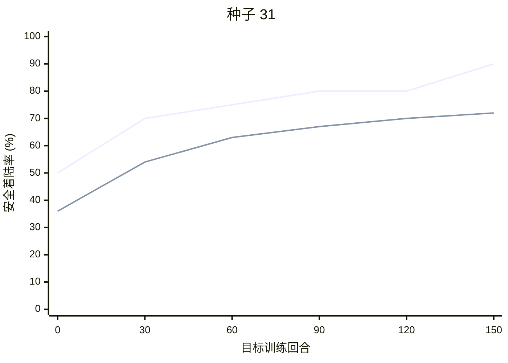
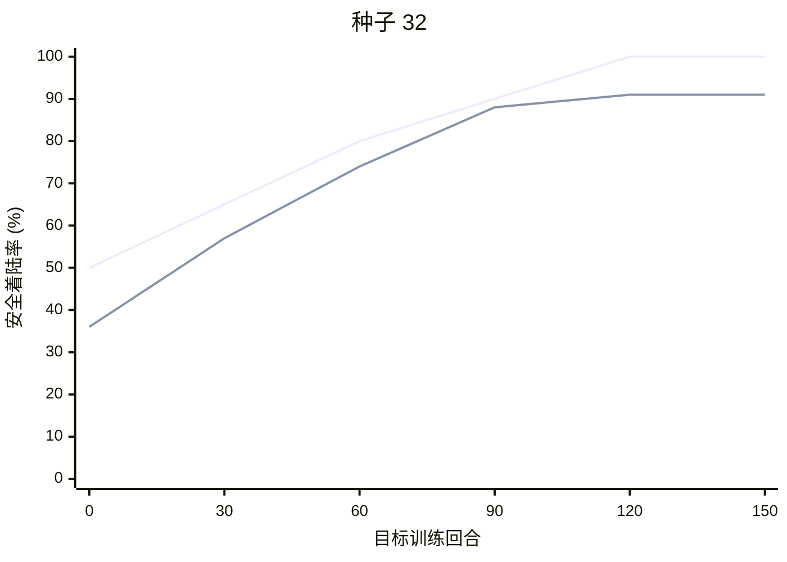
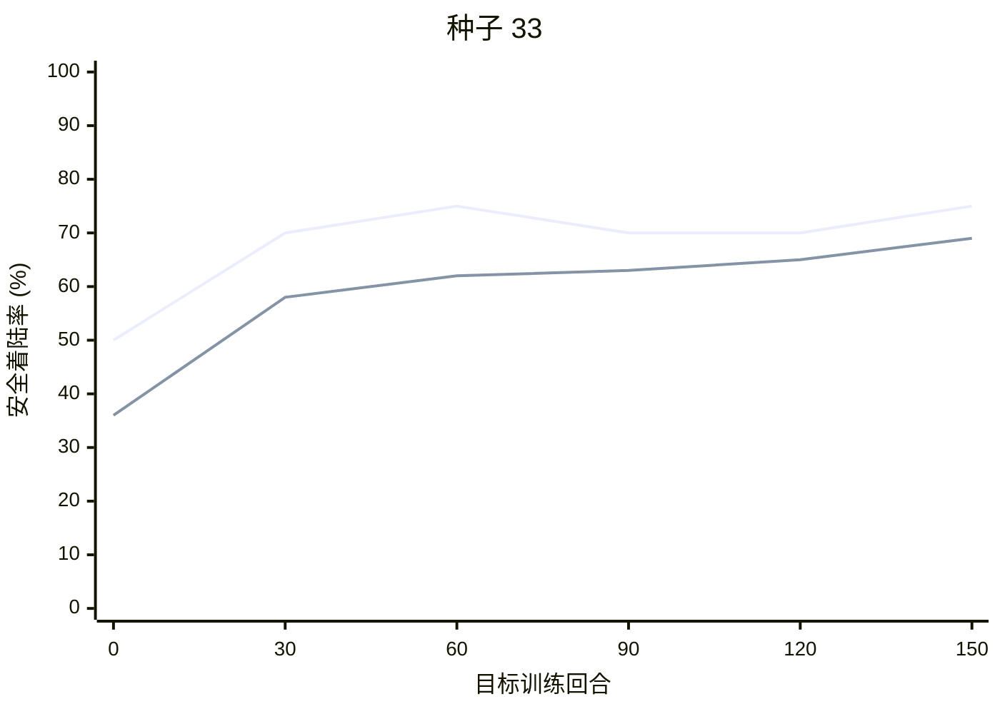
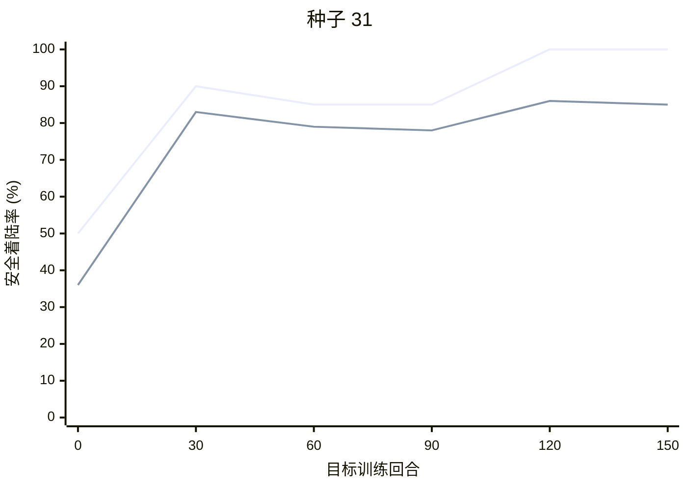
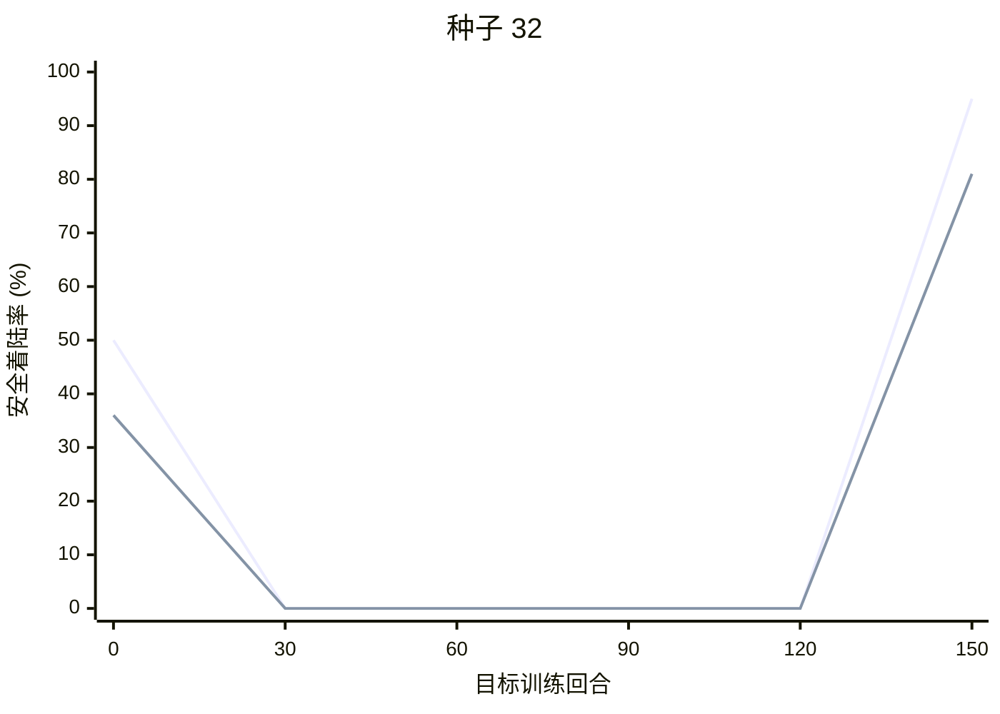
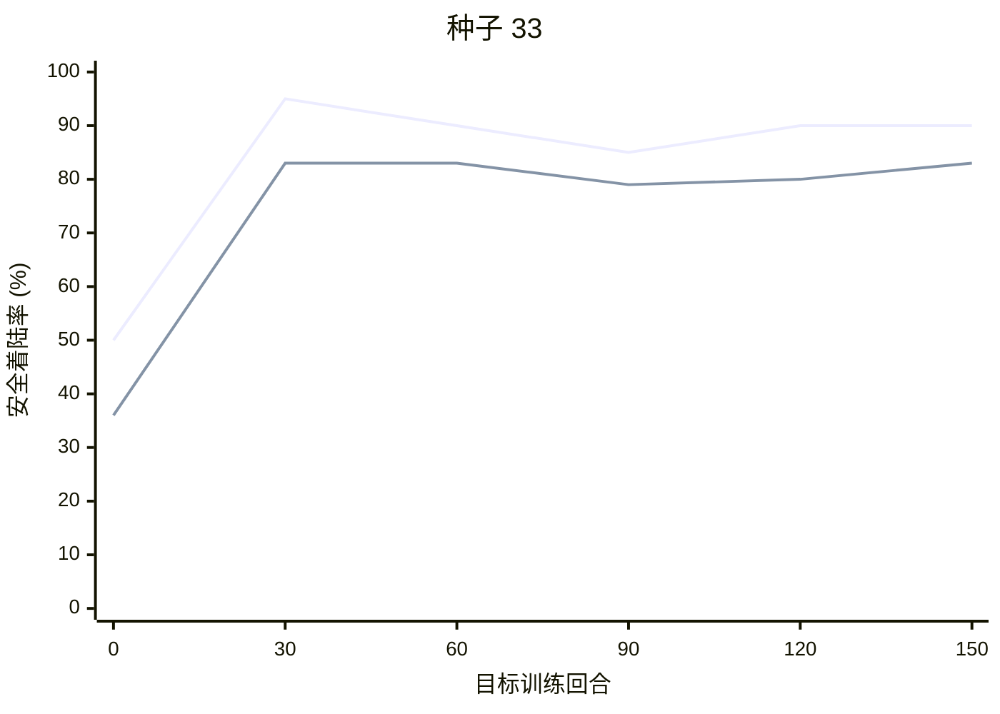
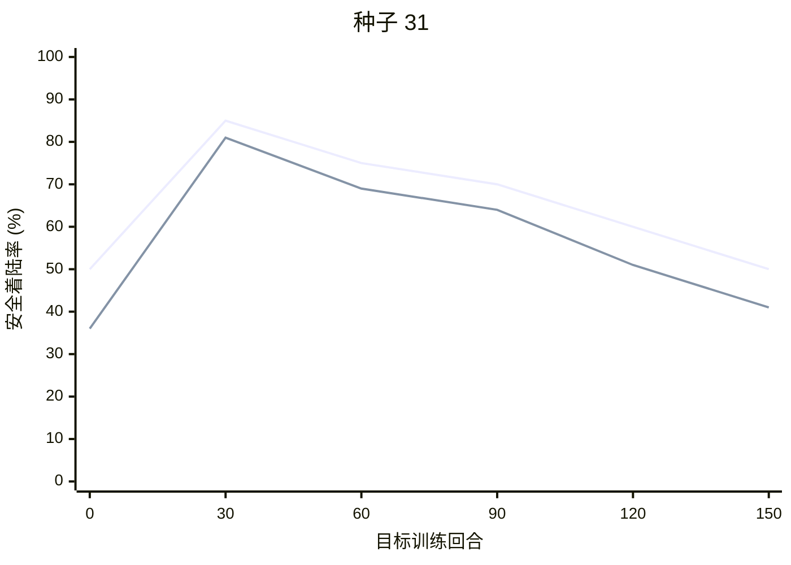
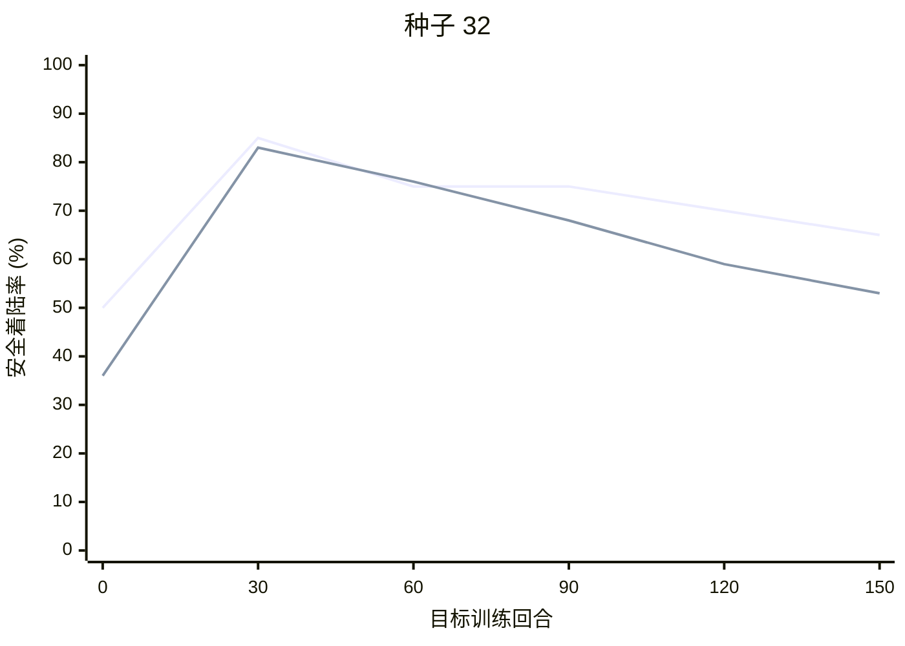
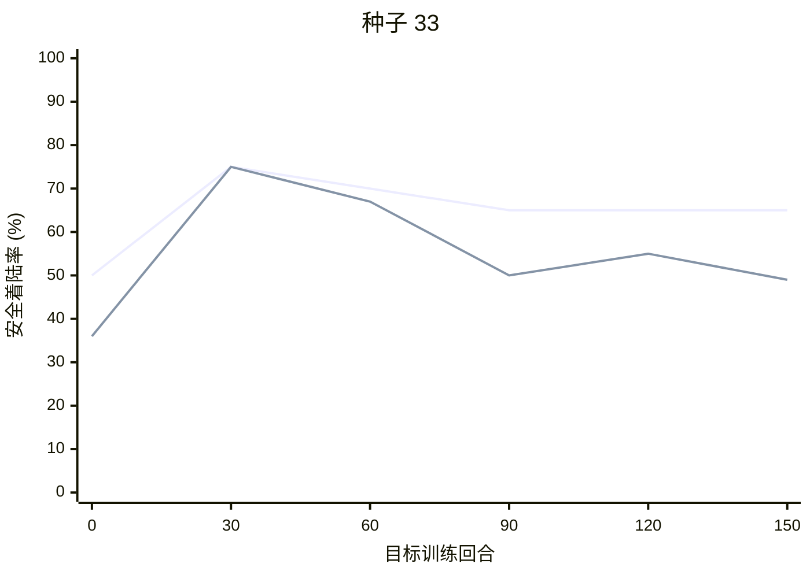

# 模拟器内的迁移适配

2026-11-26，团队在 A2 运行前决定将 A1 改为诊断项，允许以在线策略表现检验迁移适配。A1 的历史评分和原先的停止决定保留。新的在线运行采用 A1 主设定的世界模型学习率与源域占比。[运行前决议](#2026-11-26-的-a2-运行前决议)

P1 在线适配在唯一 actor 回退下通过 G-A2，三个种子的全量验证安全数为 86、81、83，固定测试为 83、81、80。P2 三种子均为 0/100。源域安全余量 C 未满足平均首次触地速度门槛。[P1 结果](#p1-在线适配结果) · [P2 压力档](#p2-弱姿控压力档) · [C 决策](#c-源域首次触地速度余量)

### A1 原验收记录

**零样本起点 G1 复现，P1 世界模型适配 A1 未通过。** 每个目标域收集 30 个训练回合和 50 个留出回合。P1 主设定将 15 步倾角误差从 6.213° 降至 1.685°，首次终止事件命中由 47/50 提高到 50/50。回退进一步把倾角误差降至 1.018°，仍略高于 1° 上限，同时漏掉了 5 次坠毁。两套设定均未达到进入在线策略适配的条件。低预算 20 回合与 50 回合给出了相同的停止决定，但对回退设定的四个指标有三个判定不同。

## 方法与起点复现

使用 S3 种子 33 第 22 轮的同一完整检查点恢复 actor、critic 和世界模型，保留源域观测预处理，优化器重新初始化。P1 把 pilot 的三轴惯量统一放大 4 倍，P2 放大 0.75/0.07 ≈ 10.71 倍，保持执行器力矩、初态分布和奖励一致。P2 对应短脉冲估算的弱姿控压力档，实际 KSP 逐轴能力仍待测。[目标域定义](../src/mun_agent/transfer.py) · [源域敏感性记录](TRANSFER_SENSITIVITY.md)

G1 用冻结策略在 P1 固定验证清单上独立评估，复现 **36/100 安全、27/100 安全入靶、平均回报 −36.3491**。本地 `agent/runs/adapt/g1.json` 记录了检查点、清单内容与文件摘要。A1 采集另用冻结策略加标准差 0.15 的动作噪声，P1 训练/留出根种子为 4101/4102，P2 为 4201/4202。每域分别核验目标训练、目标留出、源域预填充、验证和测试的重置种子两两互斥。源域预填充沿用已有的 S3 回放，目标域没有采集脚本示范。

两个适配设定分别从完全相同的源世界模型权重开始。每批 128 个样本，在各自回放内采样 8 步窗口，源、目标样本合并后更新世界模型。主设定用 1,000 次更新、学习率 10⁻⁴、源域占比 0.5。唯一回退用 3,000 次更新、学习率 3×10⁻⁴、源域占比 0.2。actor 和 critic 在 A1 保持冻结。各设定共享本域同一批 30 个训练回合，留出回合仅供离线评分。[A1 配置](../configs/adapt_a1.json) · [初始化与微调](../src/mun_agent/adapt.py)

## A1 的门槛与结果

沿用 S1 评分。W1 比较 1、5、15、32 步开环预测的位置、速度和倾角误差，各项须至多为状态保持基线的一半。15 步另有 0.5 m、0.2 m/s、1° 上限。下表列出 12 项中误差相对上限最大的那一项，本次所有行都是 **15 步全体终点的倾角平均绝对误差**。W2 在真实终点高度低于 10 m 的 15 步窗口上，要求速度误差均值 ≤0.2 m/s 且倾角平均绝对误差 ≤1°。P1 前 20 / 全 50 回合分别提供 1,389 / 3,394 个近地终点，P2 分别为 797 / 2,107 个。

W4 在每个真实状态上预测下一步，每回合只对首次预测终止评分。类型正确且与真实终止相差至多一步才命中。要求总体 ≥95%、安全和坠毁两类各自 ≥90% 且均有样本，所有真实非终止步的平均预测终止概率 ≤1%。W5 从结束前第 15 步起按记录动作开环预测，预测与真实累计回报相差 ≤25 记为命中。所有回合均须有完整的 15 步尾窗，命中率须 ≥85%。所以 50 回合至少要命中 48 个 W4 和 43 个 W5。20 回合数值对照分别要 19 个和 17 个。正式 S1 验收还要求至少 50 回合。[S1 报告实现](../src/mun_agent/deterministic_report.py)

### 全部 50 个留出回合

下表的 ✓ / ✗ 表示相应整项门槛的判定。W2 速度单位为 m/s，倾角单位为度。W4 分组列依次是安全、坠毁。

| 目标域 / 模型 | W1 全体倾角（°） | W2 近地速度 / 倾角 | W4 首次终止命中 | W4 安全 / 坠毁分组命中 | W5 回报命中 |
|---|---:|---:|---:|---|---:|
| P1 / 源模型 | ✗ 6.213 | ✗ 0.386 / 4.542 | ✗ 47/50 | 15/18 · 32/32 | ✗ 41/50 |
| P1 / 主设定 | ✗ 1.685 | ✗ 0.343 / 1.353 | ✓ 50/50 | 18/18 · 32/32 | ✓ 45/50 |
| P1 / 回退 | ✗ 1.018 | ✗ 0.217 / 0.842 | ✗ 45/50 | 18/18 · 27/32 | ✗ 42/50 |
| P2 / 源模型 | ✗ 9.813 | ✗ 1.285 / 14.743 | ✗ 49/50 | 0/1 · 49/49 | ✗ 29/50 |
| P2 / 主设定 | ✗ 1.971 | ✗ 0.603 / 2.934 | ✗ 49/50 | 0/1 · 49/49 | ✗ 29/50 |
| P2 / 回退 | ✗ 1.213 | ✗ 0.308 / 1.524 | ✗ 47/50 | 0/1 · 47/49 | ✗ 25/50 |

### 同一清单的前 20 个回合

数值门槛保持相同，仅用于估算低成本验证能否给出一致判断。前 20 条直接取自完整留出回放，不另采样，也不计作 A2 廉价策略验证。

| 目标域 / 模型 | W1 全体倾角（°） | W2 近地速度 / 倾角 | W4 首次终止命中 | W4 安全 / 坠毁分组命中 | W5 回报命中 |
|---|---:|---:|---:|---|---:|
| P1 / 源模型 | ✗ 6.273 | ✗ 0.328 / 4.302 | ✗ 19/20 | 7/8 · 12/12 | ✗ 16/20 |
| P1 / 主设定 | ✗ 1.591 | ✗ 0.294 / 1.193 | ✓ 20/20 | 8/8 · 12/12 | ✓ 18/20 |
| P1 / 回退 | ✓ 0.918 | ✓ 0.164 / 0.695 | ✗ 18/20 | 8/8 · 10/12 | ✓ 19/20 |
| P2 / 源模型 | ✗ 10.119 | ✗ 1.581 / 15.733 | ✗ 20/20 | 无样本 · 20/20 | ✗ 12/20 |
| P2 / 主设定 | ✗ 1.923 | ✗ 0.696 / 2.987 | ✗ 20/20 | 无样本 · 20/20 | ✗ 10/20 |
| P2 / 回退 | ✗ 1.211 | ✗ 0.369 / 1.594 | ✗ 19/20 | 无样本 · 19/20 | ✗ 11/20 |

P1 主设定在两种样本量下均通过 W4、W5，仍未通过 W1、W2。回退在完整 50 回合中，W1 的 12 项仅 15 步倾角超限。W2 达到倾角上限要求，但速度误差为 0.21695 m/s。W4 漏报的 5 次均为坠毁，坠毁召回为 27/32（84.375%），非终止步平均预测终止概率为 0.02018%，低于 1% 上限。W5 的 42/50 距离通过相差 1 个回合，8 个失手回合均为坠毁。取前 20 条会将 W1、W2、W5 都判为通过，W4 仍低于门槛。由此可以用 20 条发现当前设定有问题，无法据此准确定位全部薄弱环节。

P2 的 50 条留出中有 49 次坠毁、1 次安全，三个模型都错过这唯一的安全终局。前 20 条全部坠毁，安全类命中率无从估计。源模型和主设定即使总体 20/20 也不能通过 W4。各域两种样本量、各模型的非终止步平均预测终止概率均低于 1%。这些结果说明此次数据与配方尚不足以证明弱姿控域的适配能力。读到真实参数的脚本曾在 P2 取得 0/100 安全，现有试验仍不能断定该域是否具备物理上安全着陆的能力。

## 交互预算与后续门槛

四类预算按真实模拟器交互分别记账。表内“回合 / 转移”只计算实际环境步。A1 对同一留出回放多次评分没有新增交互。

| 预算类别 | P1 已用 | P2 已用 |
|---|---:|---:|
| 目标训练回合 / 转移 | 30 / 7,122（15 安全、15 坠毁） | 30 / 6,344（1 安全、29 坠毁） |
| 廉价策略验证回合 | 0 | 0 |
| 目标留出回合 / 转移 | 50 / 11,736（18 安全、32 坠毁） | 50 / 10,312（1 安全、49 坠毁） |
| 全量策略诊断回合 | 100（独立零样本 G1） | 0 |

A1 的成本是**每域 80 个目标回合**，P1 共 18,858 步，P2 共 16,656 步。另列的 100 个 P1 验证回合只复核零样本基线。模型更新和想象转移不计入目标环境交互。

### 原规则下的停止记录

事前规定只有通过 P1 的 A1 才启动正式 A2。计划中种子 31、32、33 共用同一份 v1 起点，每轮采 6 个目标回合，最多 25 轮，FIFO 只保存目标回合。世界模型每轮更新 200 次，actor-critic 在 64 步想象中更新 30 次，世界模型训练和想象起点沿用 A1 通过配方的源域占比。每 5 轮及第 0 轮验证，只用固定清单前 20 条按安全率、安全入靶率、原始平均回报、较晚轮次选检查点。同期 100 条全量验证只作诊断。若能完成，每种子计划为最多 150 个在线训练回合及 120 个廉价评估回合，另外单列 600 个全量诊断。此处为设计预算。[在线配置](../configs/adapt_online.json) · [评估与选择实现](../src/mun_agent/adapt.py)

实际在 A1 结束后按门槛停止。A2 正式适配和冻结世界模型对照均未启动，G-A2 未评估，没有三种子学习曲线、廉价选优一致性或最终测试成绩。P2 在线压力测试与源域安全余量 C 都以 G-A2 通过为前提，均未启动。达到 80/100 安全需要多少 KSP 训练和评估回合，当前数据无法估计，也未能判断差异是否来自世界模型微调。P2 的离线结果提示路线 A 在弱姿控条件下面临困难，仍需实测实际飞船的执行器、接触、延迟及平移耦合。所有已报告成绩来自模拟器。

## 2026-11-26 的 A2 运行前决议

团队决定按原 S1 阈值继续报告 A1，把是否放行后续实验交给策略级门槛 G-A2。P1 的 50 个留出回合上，A1 主设定正确识别全部 18 个安全终局和 32 个坠毁，W5 命中 45/50。A1 回退虽降低了近地速度和姿态误差，仍漏报 5 次坠毁。团队据此选定主设定的世界模型学习率 10⁻⁴、源域占比 0.5，用于 A2 的模型更新和想象起点采样。所有种子的 actor、critic 和世界模型均重新载入同一 v1 检查点。

- **P1 主设定。** 种子 31、32、33 各采 25 轮，每轮 6 个目标回合、200 次世界模型更新、30 次想象策略更新，actor 学习率 10⁻⁵。第 0、5、10、15、20、25 轮各用固定验证清单前 20 个起点选模。每个种子按廉价验证选出的检查点，须在同期全量验证的 100 个起点上至少安全着陆 80 次，三个种子都达到才通过 G-A2。每个种子另报全量验证所选轮次，以检验廉价选模的一致性。最终配方按验证决定，每个种子只在固定测试集评估一次。
- **唯一回退与冻结对照。** 若主设定未过 G-A2，只允许把 actor 学习率提高至 3×10⁻⁵、每轮想象更新增至 60 次。若回退仍未过，结束在线尝试，报告学习曲线及失败类型。冻结对照使用匹配的配方、三个种子及同样预算，世界模型每轮更新为 0，actor 和 critic 照常在想象中更新。
- **下游条件。** G-A2 通过后才运行 P2 在线压力档与源域安全余量 C。P2 沿用 P1 通过的配方，以三个种子报告 150 个目标训练回合内的表现。C 用种子 33 训练，首次预测触地的撞前速度超过 1.0 m/s 时按每超出 1 m/s 扣 10 分，仅影响想象训练。采纳 C 须同时达到名义验证 ≥99/100 安全且 ≥95/100 安全入靶、平均首次触地速度 ≤1.0 m/s、惯量 ×3 和 ×4 的安全数分别 ≥86 和 ≥46。

## P1 在线适配结果

**G-A2 在唯一的 actor 回退下通过。** 主设定的三个廉价选中检查点在全量验证上安全着陆 72、91、69 次，触发事先规定的回退。回退将 actor 学习率从 10⁻⁵ 增至 3×10⁻⁵，每轮想象更新从 30 增至 60 次。世界模型学习率仍为 10⁻⁴，源域占比仍为 0.5。最终三个种子全量验证分别为 **86、81、83 / 100**，固定测试分别为 **83、81、80 / 100**。在同一 P1 验证清单上，三者均高于仅行为克隆的 79/100，低于名义脚本的 87/100。[零样本基线](TRANSFER_SENSITIVITY.md)

三个种子的学习过程差异明显。回退的种子 31、33 在 30 个目标训练回合后全量验证即达到 83/100。种子 32 在 30、60、90、120 个训练回合时四次全量验证均为 0/100，分别有 95、91、88、85 次超时；到 150 个回合时恢复到 81/100。仅以提前达标或连续低分决定何时停训，会改变本次结果。三次正式运行均完成全部 25 轮。

廉价验证在三次回退中，两次选中与全量诊断相同的轮次。种子 33 选第 5 轮，全量最优为第 25 轮。两轮同为 83/100 安全，第 25 轮的安全入靶从 76 增至 81。三个廉价选中检查点的安全数都与各自全量最优相同，但廉价安全率分别高估了同期全量结果 14、14、12 个百分点。

匹配的冻结对照也从零样本的 36/100 提高到 **81、83、75 / 100**，测试为 **80、82、73 / 100**。在线更新世界模型相对冻结的逐种子验证差为 **+5、−2、+8**，测试差为 **+3、−1、+7**。两组都更新 actor、critic；本次只有在线更新世界模型的配方让三个种子同时达标。冻结组的提升和种子 32 的反例表明，总提升不能全部归于世界模型更新。

### P1 学习曲线

每组使用相同的三个适配种子。横轴为在线收集的目标训练回合数，纵轴为安全着陆率（%）。每幅图第一条线为廉价验证（20 个起点），第二条线为全量验证（100 个起点）。

<details>
<summary>主设定，种子 31、32、33</summary>

表中每格依次为廉价验证和全量验证的安全率（%）。

| 种子 / 训练回合 | 0 | 30 | 60 | 90 | 120 | 150 |
|---|---:|---:|---:|---:|---:|---:|
| 31 | 50 / 36 | 70 / 54 | 75 / 63 | 80 / 67 | 80 / 70 | 90 / 72 |
| 32 | 50 / 36 | 65 / 57 | 80 / 74 | 90 / 88 | 100 / 91 | 100 / 91 |
| 33 | 50 / 36 | 70 / 58 | 75 / 62 | 70 / 63 | 70 / 65 | 75 / 69 |







</details>

<details>
<summary>回退，种子 31、32、33</summary>

表中每格依次为廉价验证和全量验证的安全率（%）。

| 种子 / 训练回合 | 0 | 30 | 60 | 90 | 120 | 150 |
|---|---:|---:|---:|---:|---:|---:|
| 31 | 50 / 36 | 90 / 83 | 85 / 79 | 85 / 78 | 100 / 86 | 100 / 85 |
| 32 | 50 / 36 | 0 / 0 | 0 / 0 | 0 / 0 | 0 / 0 | 95 / 81 |
| 33 | 50 / 36 | 95 / 83 | 90 / 83 | 85 / 79 | 90 / 80 | 90 / 83 |







</details>

<details>
<summary>冻结（匹配回退），种子 31、32、33</summary>

表中每格依次为廉价验证和全量验证的安全率（%）。

| 种子 / 训练回合 | 0 | 30 | 60 | 90 | 120 | 150 |
|---|---:|---:|---:|---:|---:|---:|
| 31 | 50 / 36 | 85 / 81 | 75 / 69 | 70 / 64 | 60 / 51 | 50 / 41 |
| 32 | 50 / 36 | 85 / 83 | 75 / 76 | 75 / 68 | 70 / 59 | 65 / 53 |
| 33 | 50 / 36 | 75 / 75 | 70 / 67 | 65 / 50 | 65 / 55 | 65 / 49 |







</details>

### P1 检查点选择与锁定后测试

各组三个种子均只按廉价验证选轮。全量验证最优轮用于对照选模一致性。“成绩”三列均按“安全数 / 安全入靶数 / 原始平均回报”显示，每次验证或测试共 100 个起点。

| 配方 | 种子 | 廉价选中轮 | 廉价安全 / 20 | 选中轮全量成绩 | 全量最优轮 | 最优轮全量成绩 | 锁定后测试成绩 |
|---|---:|---:|---:|---|---:|---|---|
| 主设定 | 31 | 25 | 18 | 72 / 47 / 34.780 | 25 | 72 / 47 / 34.780 | 未测¹ |
| 主设定 | 32 | 25 | 20 | 91 / 90 / 70.232 | 25 | 91 / 90 / 70.232 | 未测¹ |
| 主设定 | 33 | 25 | 15 | 69 / 43 / 28.948 | 25 | 69 / 43 / 28.948 | 未测¹ |
| 回退 | 31 | 20 | 20 | 86 / 82 / 59.611 | 20 | 86 / 82 / 59.611 | 83 / 79 / 53.739 |
| 回退 | 32 | 25 | 19 | 81 / 80 / 46.575 | 25 | 81 / 80 / 46.575 | 81 / 79 / 46.862 |
| 回退 | 33 | 5 | 19 | 83 / 76 / 54.503 | 25 | 83 / 81 / 51.427 | 80 / 75 / 48.840 |
| 冻结（匹配回退） | 31 | 5 | 17 | 81 / 75 / 50.829 | 5 | 81 / 75 / 50.829 | 80 / 74 / 48.957 |
| 冻结（匹配回退） | 32 | 5 | 17 | 83 / 81 / 54.414 | 5 | 83 / 81 / 54.414 | 82 / 75 / 52.536 |
| 冻结（匹配回退） | 33 | 5 | 15 | 75 / 66 / 38.829 | 5 | 75 / 66 / 38.829 | 73 / 67 / 35.130 |

¹ 主设定未通过三种子的 G-A2，按协议只对最终配方及其匹配的冻结对照做一次固定测试。

### 在线适配的交互预算

| P1 组别（三种子合计） | 目标训练回合 / 转移 | 廉价验证回合 | 新增留出回合 | 全量验证回合 | 单独锁定后测试回合 |
|---|---:|---:|---:|---:|---:|
| 主设定 | 450 / 132,132 | 360 | 0 | 1,800 | 0 |
| 唯一 actor 回退 | 450 / 233,353 | 360 | 0 | 1,800 | 300 |
| 匹配冻结对照 | 450 / 160,414 | 360 | 0 | 1,800 | 300 |

每个种子每次尝试实际使用 150 个训练回合、120 个廉价验证回合和 600 个全量诊断回合。上表各类独立计数，包含第 0 轮，两种验证对前 20 个起点各自实际运行一次。A1 的 30 个训练与 50 个留出回合，以及独立 G1 的 100 回合，已在上文单列。最终测试也单列，未计入验证选优预算。

**对 KSP 预算的含义。** 若直接采用已选的回退配方，P1 模拟器在 31、32、33 三个种子上首次达到全量 80/100 分别用了 30、150、30 个训练回合，此时分别已做 40、120、40 个廉价评估回合。按三种子都达到这一水平的实测规划值，应为**每种子 150 个训练回合加 120 个评估回合**。这覆盖训练与选模；要单独核验最终策略，还需 100 个固定起点。P1 实际跑过的全部对照和全量诊断均已另计。实际 KSP 的接触、延迟及执行器耦合尚未校准，游戏中的达标回合数待测。

正式训练入口的 SHA-256 为 `037410bfb5e3efc43224f7d4cfb4a531e6cf5f58ad7d7b6c597c169b9b2c14a6`。主设定启动时的 Git 记录为 `a1f4bed` 加工作区改动，随后提交 `7902862` 的训练入口与运行记录的摘要逐字节一致。冻结和回退均从该提交启动。九份运行记录核对了相同的 v1、源回放、清单和配方。所有种子共享该预训练起点，验证和测试均在模拟器中完成。

## P2 弱姿控压力档

P2 的三轴惯量是名义值的约 10.71 倍。三个种子从同一 v1 出发，原始全量验证均为 0/100 安全、平均回报 −110.512。沿用 P1 通过的 actor 回退配方后，从第 0 轮到第 25 轮，三个种子在六个固定验证节点上均为 0/20 和 0/100 安全。三个带噪训练集共 450 个回合，也没有安全着陆。

| 种子 | 廉价选中轮 | 全量安全 / 入靶 | 全量坠毁 / 超时 | 原始平均回报 | 目标训练回合 / 转移 |
|---|---:|---:|---:|---:|---:|
| 31 | 20 | 0 / 0 | 75 / 25 | −108.154 | 150 / 63,367 |
| 32 | 15 | 0 / 0 | 78 / 22 | −109.497 | 150 / 58,591 |
| 33 | 25 | 0 / 0 | 72 / 28 | −107.978 | 150 / 64,759 |

P2 共使用 450 个目标训练回合（186,717 个转移）、360 个廉价验证回合、0 个新增留出回合和 1,800 个全量诊断回合，各轮的安全与安全入靶均为零，选点取决于原始回报。此前即使让脚本控制器读取真实参数，在 P2 也只有 0/100 安全。路线 A 若实际落在这一姿控范围，当前模拟器预训练加有限在线适配尚未表现出安全着陆能力。物理可达性仍待验证，实际 KSP 的姿控能力需实测。

## C 源域首次触地速度余量

G-A2 通过后，以种子 33 按 S3 原始名义训练流程从 S1 世界模型重新训练。沿用相同的 6,000 次行为克隆、数据、网络和固定验证清单，完成 24 轮、960 次世界模型和 720 次策略更新。唯一新增的训练项对每段想象中首次预测的空中→触地转移，用最后一个空中状态的三维速度按 `10 × max(0, 速度 − 1.0 m/s)` 扣分。起步时已贴地不会扣分，随后复飞并重新着地算作本段想象的首次触地。环境评估使用原奖励和 2.0 m/s 触地上限。

在实现核对中，首次启动把已经贴地的起点当作本窗口已经触地。该次运行中止并单独归档；修正后从 S1 和相同随机种子完整重跑。正式运行的奖励与启动脚本摘要均与代码提交 `3e572a3` 一致，原始 S3 训练文件未改动。行为克隆结束时，三个网络的参数与原种子 33 对应快照逐张量相等。

用原名义验证排序选中第 12 轮，平均原始回报 92.9263。锁定后，三种控制器共用原迁移敏感性评估代码和同一份 100 起点验证清单。每格为**安全数 / 安全入靶数**。

| 验证条件 | C | 原 v1 | 仅行为克隆 |
|---|---:|---:|---:|
| 名义 | 100 / 100 | 100 / 100 | 100 / 100 |
| 惯量 ×2.5 | 97 / 68 | 94 / 71 | 98 / 88 |
| 惯量 ×3 | 89 / 49 | 76 / 53 | 97 / 75 |
| 惯量 ×4 | 57 / 35 | 36 / 27 | 79 / 52 |

**按事先规则不将 C 纳入校准后重训配方。** 名义 100/100 安全且全部入靶，达到 ≥99 安全、≥95 安全入靶的要求。惯量 ×3、×4 的安全数分别提高 13 和 21，均超过规定下限 86 和 46。名义平均首次触地速度从 v1 的 1.35597 m/s 降至 **1.01526 m/s**，超过 1.0 m/s 上限。三项须同时通过。详细决策与分条件指标见本地 `agent/runs/adapt/c/decision.json`。

## 复现

从仓库根目录运行，使用安装了项目依赖的 CPU Python 环境。需要本地 S3 完整训练检查点 `agent/runs/s3-stable/seed-33/checkpoints/best.pt`（SHA-256 前缀 `a4451b97`）、源域回放 `agent/data/s3-nominal-prefill`（`b26f50ac`）和两份冻结清单。A1 和 A2 训练阶段读取测试清单的摘要与重置种子，最终策略测试单独执行。脚本在加载时核对输入的完整 SHA-256。[运行入口](../scripts/adapt.py) · [S3 归档说明](S3_HANDOFF.md)

```sh
python agent/scripts/adapt.py g1
python agent/scripts/adapt.py a1 --domain P1
python agent/scripts/adapt.py a1 --domain P2
```

A2 的三种子均从同一份 v1 权重起步。下面的命令按本次实际顺序列出。主设定的三个验证结果决定是否启用 actor 回退。冻结对照只运行与最终配方匹配的三次。每个最终选中的在线和冻结检查点各测试一次，测试结果不参与选模。

```bash
adapt() { python agent/scripts/adapt.py "$@"; }
root=agent/runs/adapt/a2/P1
seeds=(31 32 33)
main=()
fallback=()
for seed in "${seeds[@]}"; do
    adapt a2 --domain P1 --variant main --seed "$seed"
    main+=("$root/online-main/seed-$seed/summary.json")
done
for seed in "${seeds[@]}"; do
    adapt a2 --domain P1 --variant fallback --seed "$seed" --p1-main "${main[@]}"
    adapt a2 --domain P1 --variant frozen --recipe fallback --seed "$seed" --p1-main "${main[@]}"
    fallback+=("$root/online-fallback/seed-$seed/summary.json")
done
for group in online-fallback frozen-fallback; do
    for seed in "${seeds[@]}"; do
        adapt test --out "$root/$group/seed-$seed" --p1-main "${main[@]}" --p1-fallback "${fallback[@]}"
    done
done

# G-A2 通过后运行。
for seed in "${seeds[@]}"; do
    adapt a2 --domain P2 --variant fallback --seed "$seed" --p1-main "${main[@]}" --p1-fallback "${fallback[@]}"
done
adapt c --p1-main "${main[@]}" --p1-fallback "${fallback[@]}"
```

每个 A2 运行目录的 `learning-curve.json` 保存六次廉价和全量验证，`training.json` 保存 25 轮采集及参数更新记录，`summary.json` 记录廉价所选和全量诊断最优轮次，`test.json` 记录锁定检查点后的最终测试。初态与数据摘要见各组 `config.json`，目标训练回放按轮保存在 `agent/data/adapt-a2-*`。脚本拒绝覆盖既有运行或再次测试同一个运行目录。

原始评估保存在 `agent/runs/adapt/a1/{P1,P2}/{source,main,fallback}-{20,50}.json`，同目录下的 `summary.json` 记录每次拟合的配方、回放 SHA-256 和状态计数。数据在 `agent/data/adapt-{p1,p2}-a1-{train,heldout}/`。若要保留既有输出，用 `--out` 指向新的空路径，复用已校验的回放。

在本机 CPU 上，从同一训练与留出回放独立重跑了两个域的主设定与回退。12 份逐回合评估报告逐字节相同，四份模型的全部状态张量逐项相等。两起点、一轮的工程测试核对了冻结与可更新世界模型两条路径、四类计数、廉价验证选优及原 S3 想象回报。编译通过，根目录 53 项测试中 2 项跳过，模拟器 61 通过、1 跳过，智能体 122 通过、1 跳过。

本次规则变更及 C 实现完成后，编译检查通过。根目录共运行 53 项（跳过 2 项），模拟器 61 项通过、跳过 1 项，智能体 125 项通过、跳过 1 项。新增测试覆盖按窗口首次触地、复飞后落地、撞前速度、重复接触和关闭选项后的原始 S3 回报。
